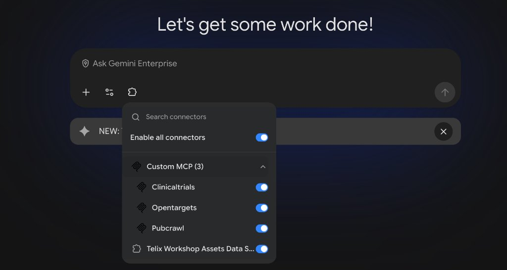
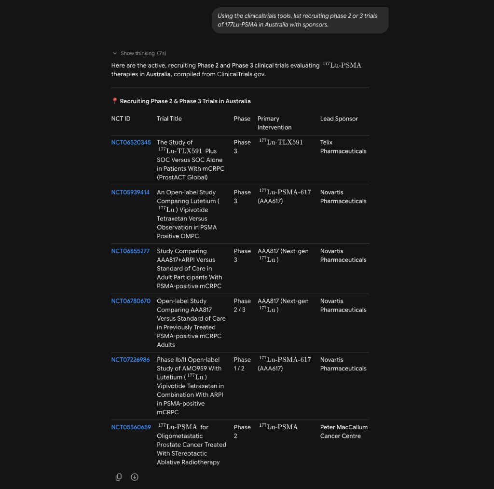
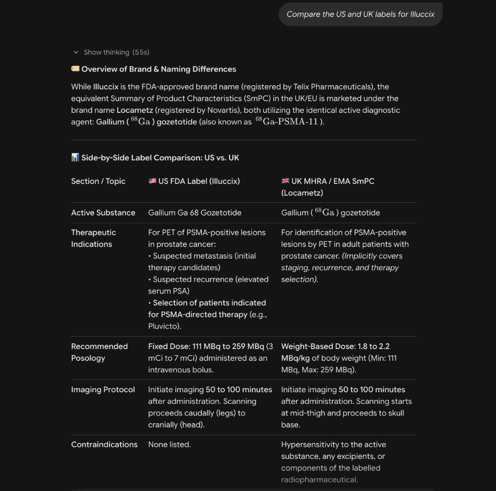
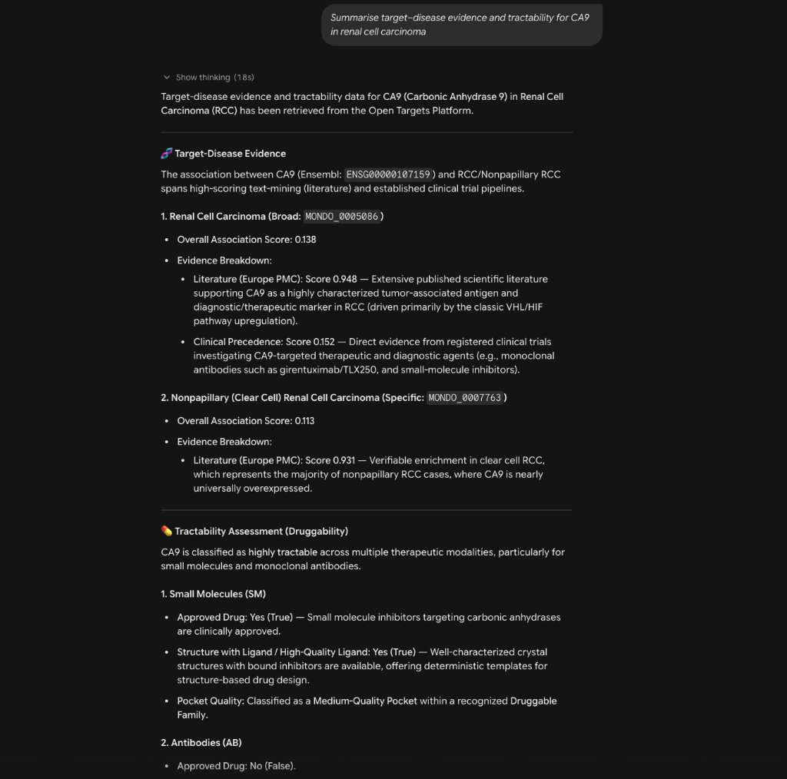

# telix-connectors — Runbook for Niveus / NTT

**Goal:** make three public‑data MCP servers — **ClinicalTrials.gov**, **PubMed / Europe PMC (PubCrawl)**, **Open Targets** —
available as tools in **Telix's Gemini Enterprise (GE)** app, hosted in the EU, with no Telix documents in scope.
Later the same template adds licensed sources (PatSnap, Article Galaxy).

This repo was built and run end‑to‑end by Google before hand‑over (deploy → test → register → add to GE → used in chat).
Expected outputs are shown at every step. **Follow the steps in order.** Steps marked **🔒 TELIX TENANT** need an action
or confirmation from a Telix administrator (Jellen Mattens – IT / Vincent Ho – Cyber Security); do not work around them.

```
Order of work
  Day 0   🔒 T0.1–T0.3 (Telix)                 org policy, egress, InfoSec sign‑off   ← longest lead item, start first
  Day 1   steps 1–4 for clinicaltrials, pubcrawl, opentargets   (you; ~1 h total)
  Day 1/2 step 5 for all three in ONE session   (Telix GE admin, you on the call; ~15 min)
  Day 2   step 6 verification                  (Telix researcher; 5 min)  →  step 7 hand‑over record
```

---

## 0. Prerequisites

| Item | Value | How to confirm |
|---|---|---|
| GCP project that hosts the GE app | `<TELIX_PROJECT_ID>` | Console → **AI Applications** → **Apps** → note the project in the URL |
| Region for connectors | `europe-west4` | agreed (EU data residency) |
| GE app location | `eu` | **AI Applications** → **Apps** → *Location* column |
| Your IAM roles on that project | `roles/run.admin` · `roles/cloudbuild.builds.editor` · `roles/artifactregistry.admin` · `roles/iam.serviceAccountAdmin` · `roles/iam.serviceAccountUser` · `roles/secretmanager.admin` · `roles/agentregistry.editor` · `roles/serviceusage.serviceUsageAdmin` | `gcloud projects get-iam-policy <TELIX_PROJECT_ID> --flatten='bindings[].members' --filter='bindings.members:<you>' --format='value(bindings.role)'` |
| Laptop tools | `gcloud` ≥ 540, `git`, `curl`, `python3`; optional `uv` for the functional test | `gcloud version` |

**🔒 TELIX TENANT — must be done before step 5 will work; start on day 0**

- [ ] **T0.1 Org policy (blocking).** GE blocks custom MCP connectors by default through the managed constraint
  `discoveryengine.managed.disableCustomMcpServerConnector` (it was enforced in Google's reference project too).
  A Telix **Organization Policy Administrator** (`roles/orgpolicy.policyAdmin`) sets a project‑level override:
  ```bash
  gcloud services enable orgpolicy.googleapis.com connectors.googleapis.com --project=<TELIX_PROJECT_ID>   # wait ~1 min
  cat > /tmp/ge_mcp_policy.yaml <<EOF
  name: projects/<TELIX_PROJECT_ID>/policies/discoveryengine.managed.disableCustomMcpServerConnector
  spec:
    rules:
    - enforce: false
  EOF
  gcloud org-policies set-policy /tmp/ge_mcp_policy.yaml --project=<TELIX_PROJECT_ID> --billing-project=<TELIX_PROJECT_ID>
  gcloud org-policies describe discoveryengine.managed.disableCustomMcpServerConnector --project=<TELIX_PROJECT_ID> --effective
  # expect:  rules: - enforce: false      (if set-policy says SERVICE_DISABLED, wait a minute and retry)
  ```
  Two related constraints must also not block it: `discoveryengine.managed.allowedDataSources` must allow `custom_mcp`
  (or be unset) and `discoveryengine.managed.allowedEgressFqdns` must be unset or list each connector host
  (`mcp-<name>-<PROJECT_NUMBER>.europe-west4.run.app`).

  > **Caveat — longest‑lead item.** This needs `roles/orgpolicy.policyAdmin`, which Niveus/NTT will not hold in the Telix
  > organisation. It is a **Telix action (Jellen Mattens / Vincent Ho)** and may need Telix change control. Raise it on
  > day 0; nothing in step 5 works until the effective policy shows `enforce: false`.
- [ ] **T0.2 Egress.** Outbound HTTPS/443 from Cloud Run in `europe-west4` to `clinicaltrials.gov`, `eutils.ncbi.nlm.nih.gov`,
  `www.ebi.ac.uk`, `api.platform.opentargets.org` is allowed (re‑confirm if VPC Service Controls or a Secure Web Proxy
  were added to the project).
- [ ] **T0.3 Scope sign‑off.** Vincent Ho has reviewed [`docs/infosec-dataflow.md`](docs/infosec-dataflow.md)
  (what leaves the tenant: search terms only; read‑only tools; EU hosting).

---

## 1. Clone and configure (5 min)

```bash
git clone https://github.com/soheilage/telix-connectors.git && cd telix-connectors
gcloud auth login                                   # your identity on the Telix project
export PROJECT_ID=<TELIX_PROJECT_ID> REGION=europe-west4 REGISTRY_LOCATION=eu
gcloud config set project $PROJECT_ID
```
All scripts refuse to run if `PROJECT_ID` is not set.

## 2. Deploy the three connectors (≈10 min each, mostly Cloud Build)

```bash
template/deploy.sh clinicaltrials
template/deploy.sh pubcrawl
template/deploy.sh opentargets
```
Each run: enables APIs → creates Artifact Registry repo `mcp-connectors` → creates a dedicated runtime service account
`mcp-<name>@…` with no project roles → Cloud Build from `template/Dockerfile` → Cloud Run service `mcp-<name>`
(**private**, `europe-west4`, 0–3 instances) → grants `roles/run.invoker` to the test identity `mcp-tester@…` and to
the **Gemini Enterprise service agent** `service-<PROJECT_NUMBER>@gcp-sa-discoveryengine.iam.gserviceaccount.com`.

It ends with a block like:
```
DONE  mcp-clinicaltrials
  URL:        https://mcp-clinicaltrials-<PROJECT_NUMBER>.europe-west4.run.app/mcp
  Runtime SA: mcp-clinicaltrials@<TELIX_PROJECT_ID>.iam.gserviceaccount.com
```
**Record the three URLs** (also: `gcloud run services describe mcp-<name> --region=$REGION --format='value(status.url)'` + `/mcp`).

Notes
- If `deploy.sh` prints `WARN service-…@gcp-sa-discoveryengine… not found`, the GE app is in another project →
  re‑run with `--allow-caller service-<GE_PROJECT_NUMBER>@gcp-sa-discoveryengine.iam.gserviceaccount.com`.
- PubCrawl works without a key; to lift PubMed's rate limit (3 → 10 req/s) create the secret **before** deploying:
  `gcloud secrets create ncbi-api-key --replication-policy=automatic && printf '%s' "<KEY>" | gcloud secrets versions add ncbi-api-key --data-file=-`
  (free key from https://www.ncbi.nlm.nih.gov/account/). If the secret is absent, deploy continues without it.

## 3. Smoke test (1 min each)

```bash
template/smoke.sh clinicaltrials      # then pubcrawl, opentargets
```
`smoke.sh` calls the private service with a token for `mcp-tester@…` (deploy.sh granted you permission to impersonate it).
Expected:
```
== initialize
{'name': 'clinicaltrials', 'version': '…'}
== tools/list
4 tools:  search_trials · get_trial · trial_locations · trials_by_sponsor      (pubcrawl: 14 tools, opentargets: 5 tools)
wrote servers/clinicaltrials/tools.json (…) for Agent Registry tool-spec
```
`== health HTTP 404` is expected (the Cloud Run front end does not route `/healthz`); only the MCP calls matter.
`401/403` on `initialize` within the first minute after deploy = IAM propagation — wait 30 s and re‑run.

Optional functional check (one real tool call per connector, from your laptop):
```bash
uv venv && . .venv/bin/activate && uv pip install -r template/proxy/requirements.txt
python tests/cloud_functional.py
# [clinicaltrials] … search_trials(177Lu PSMA, Australia) → "total":26 …
# [pubcrawl]       … search_pubmed(...) → "pmid": …
# [opentargets]    … search_entities(["FOLH1","CA9"]) → "ENSG00000086205" …
```

## 4. Register in Agent Registry (1 min each)

```bash
template/register.sh clinicaltrials   # then pubcrawl, opentargets
gcloud agent-registry mcp-servers list --project=$PROJECT_ID --location=eu
# Telix clinicaltrials MCP · Telix pubcrawl MCP · Telix opentargets MCP
```
Registration is governance metadata (discovery, policy); it does not grant access.

## 5. Add the connectors to the GE app (console, ~15 min for all three)

**🔒 TELIX TENANT — performed by a Telix GE admin (Jellen) with you on the call.** Exact console wording:

1. Google Cloud console → product **AI Applications** (left nav *Apps · Data Stores · Billing · Monitoring · Settings*)
   → **Apps** → click the Telix app (row shows *Type: Gemini Enterprise*, *Location: eu*).
2. In the app: **Connected data stores** → **+ New data store** → page *Select a data source*.
3. In the **MCP servers** group choose **Custom MCP Server**.
4. Fill the form:
   - **MCP server URL** — paste the **real URL from step 2, ending in `/mcp`**, e.g.
     `https://mcp-clinicaltrials-<PROJECT_NUMBER>.europe-west4.run.app/mcp`.
     Must be the default `*.run.app` URL (GE only sends its credential to that domain). Never paste a placeholder.
   - **Authentication** — use the option that does **not** configure OAuth 2.0 (“No authentication”). The service is still
     private: GE sends a Google OIDC token for its service agent in `X-Serverless-Authorization`, which Cloud Run IAM
     validates against the `roles/run.invoker` grant made in step 2.
   - **Name** — `clinicaltrials` / `pubcrawl` / `opentargets` (short; users see it as the connector name).
5. **Create** → open the new data store → **Actions** → **Reload custom actions**. When the tool list appears,
   click **Enable actions** and select all tools (they are disabled until you do; limit 100 per server).
6. Repeat 2–5 for the other two URLs.

Checks
- [ ] **T5.1** Tool names match `servers/<name>/tools.json` (4 / 14 / 5).
- [ ] **T5.2** Screenshot of each data store with actions enabled → PoC folder.
- [ ] **T5.3** If the *Custom MCP Server* tile is missing or greyed → T0.1 not effective, or the admin lacks `roles/discoveryengine.admin`.
- [ ] **T5.4** If **Reload custom actions** fails, the error text tells you why:

  | Error text contains | Cause | Fix |
  |---|---|---|
  | `Operation denied by org policy` | T0.1 / allowedDataSources / allowedEgressFqdns | Telix Org Policy Admin |
  | `HTTP 400 … Error 400 (Bad Request)` and host like `mcp-…-%3Cn%3E…` | a placeholder was pasted | paste the real URL |
  | `HTTP 404 … Not Found` | URL without `/mcp` (older builds) | edit URL, add `/mcp` |
  | `HTTP 401` / `HTTP 403` | service agent lacks `roles/run.invoker`, or URL is not `*.run.app` | re‑run `deploy.sh <name>` (grants it) |
  | `Session terminated` / connection lost | service cold start or crash | retry; check Cloud Run logs for `mcp-<name>` |

## 6. Verify as a Telix user (5 min)

**🔒 TELIX TENANT — a Telix researcher (David Han / Iva Kulic) in the GE web app**
1. In the chat box click the **connector** icon (puzzle piece next to **+**). Under **Custom MCP (3)** you should see
   *Clinicaltrials*, *Pubcrawl*, *Opentargets* with their toggles on (**Enable all connectors** at the top):

   

2. New chat → *"Using the clinicaltrials tools, list recruiting phase 2 or 3 trials of 177Lu‑PSMA in Australia with sponsors."*
   Expect a call to `search_trials` and NCT ids in the answer (e.g. NCT06520345, Telix's 177Lu‑TLX591 study).
3. Two more prompts, one per connector: *"Compare the US and UK labels for Illuccix"* (pubcrawl) and
   *"Summarise target–disease evidence and tractability for CA9 in renal cell carcinoma"* (opentargets).
Expected results (from Google's rehearsal — the same prompts should produce equivalent answers in Telix's tenant):

| clinicaltrials | pubcrawl | opentargets |
|---|---|---|
|  |  |  |
| Table of recruiting Ph2/3 ¹⁷⁷Lu‑PSMA trials in AU incl. NCT06520345 (Telix) | US vs UK label comparison, dose/imaging/contraindications | CA9 association scores (ENSG00000107159), tractability by modality |

> **Note for researchers — prompt precision.** In the rehearsal, *"Compare the US and UK labels for Illuccix"* returned the US
> Illuccix label against **Locametz** as the UK/EU comparator. Illuccix also holds UK/EU authorisations; the model chose a
> comparator because the prompt did not pin product and jurisdiction. This is model interpretation, not a connector fault.
> Name the product, market and document explicitly (e.g. *"Compare the FDA USPI for Illuccix with the MHRA SmPC for Illuccix"*),
> and check the returned identifiers (PMID, NCT, SmPC source) that the connectors surface before relying on an answer.

- [ ] **T6.1** Screenshots of the three answers → PoC folder.

## 7. Hand‑over record

Add one row per connector to [`docs/deployments.md`](docs/deployments.md) (URL, image tag, who verified in GE) and tick
[`docs/checklist.md`](docs/checklist.md). That is the deliverable.

---

## Adding a licensed source later (PatSnap, Article Galaxy)

1. Copy `servers/_template_licensed_stdio` (self‑hosted server + credentials, e.g. PatSnap) or
   `servers/_template_licensed_remote` (vendor‑hosted HTTP endpoint + token, e.g. Article Galaxy) to `servers/<name>`.
2. Edit `install.sh` (pin a commit), `server.env` (`UPSTREAM_CMD` **or** `UPSTREAM_URL`), `secrets.txt` (`ENV=secret-name`).
3. Create the secrets in Secret Manager. Add a row to `SOURCES.md`.
4. **🔒 TELIX TENANT** — David Han confirms with the vendor that API/MCP use is allowed under Telix's licence; Vincent confirms
   the credential is read‑only and `docs/infosec-dataflow.md` is updated with the new endpoint.
5. Steps 2–7 above.

## How it works (one paragraph)

`template/proxy/server.py` wraps any upstream MCP server — a stdio process (`UPSTREAM_CMD`) or a remote streamable‑HTTP
endpoint (`UPSTREAM_URL`) — and exposes it as streamable HTTP at `/mcp` (and `/`). It runs on Cloud Run with
`--no-allow-unauthenticated`, so only principals with `roles/run.invoker` (the GE service agent and the tester SA) can reach
it; Cloud Run strips the credential before the request reaches the app. Upstream public APIs are called over HTTPS with
only the query parameters. Tools are read‑only. One image serves all connectors; `servers/<name>/` holds only the pinned
install and environment.

## Layout
```
template/   Dockerfile · cloudbuild.yaml · proxy/server.py · deploy.sh · smoke.sh · register.sh
servers/    clinicaltrials (in‑house) · pubcrawl · opentargets · _template_licensed_stdio · _template_licensed_remote
docs/       infosec-dataflow.md · checklist.md · deployments.md · images/
tests/      e2e_local.sh (no cloud needed) · local_client.py · cloud_functional.py
SOURCES.md  upstream repo, licence, pinned version, endpoints, credentials per connector
```

## Troubleshooting
| Symptom | Cause / fix |
|---|---|
| `deploy.sh` fails on `gcloud secrets add-iam-policy-binding` | secret in `servers/<name>/secrets.txt` does not exist → create it or delete the line |
| `smoke.sh` → `401`/`403` | IAM propagation (wait 30 s) or `mcp-tester` lacks `roles/run.invoker` → re‑run `deploy.sh` |
| `smoke.sh` → `Invalid account type for --audiences` | you ran `gcloud auth print-identity-token` directly; use `smoke.sh` (impersonation) |
| `register.sh` → `invalid_argument … _meta` or spec too large | re‑run `smoke.sh` first (it writes a compact, valid `tools.json`) |
| GE: tools listed but model never calls them | **Enable actions** not clicked, or connector toggled off in the user's connector picker |
| First call slow (>10 s) | cold start at min‑instances 0; `gcloud run services update mcp-<name> --region=$REGION --min-instances=1` for demo days |
| PubMed `429` | add `ncbi-api-key` secret and re‑deploy pubcrawl |

## Local test without any cloud account
```bash
uv venv && . .venv/bin/activate && uv pip install -r template/proxy/requirements.txt "mcp>=1.10"
bash tests/e2e_local.sh
# 4 tools … search_trials("177Lu PSMA", country=Australia) → total=26 (incl. NCT06520345) · auth: no-token → 401, bad-token → 401
```
